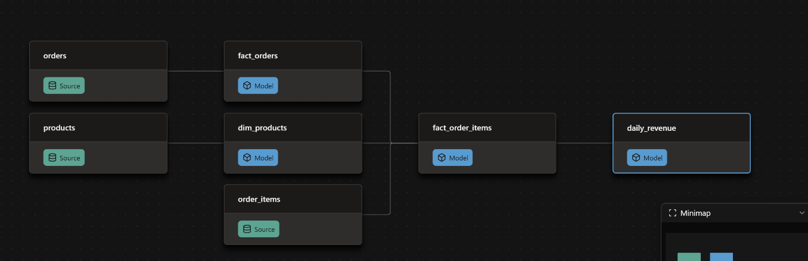

# stylehub_dbt — Bài tập Buổi 7

Project dbt (BigQuery) xây dựng các lớp Silver và Gold cho dữ liệu StyleHub.

## Cấu trúc

```
models/
├── bronze/_sources.yml        # khai báo source stylehub_bronze
├── silver/                    # fact_orders, fact_order_items, dim_products, dim_users, fact_shipments, ...
└── gold/daily_revenue.sql     # bảng Gold: doanh thu theo ngày
analyses/
└── check_amount.sql           # kiểm tra amount = sale_price * quantity
macros/
└── latest_rank.sql            # ROW_NUMBER() lấy phiên bản mới nhất
```

## Phần 1 — `daily_revenue`

Đọc `fact_order_items` bằng `ref()`, mỗi dòng là một ngày đặt đơn:

| Cột | Ý nghĩa |
|---|---|
| `order_date` | Ngày đặt đơn |
| `total_orders` | Số đơn khác nhau trong ngày (`COUNT(DISTINCT order_id)`) |
| `revenue` | Tổng `amount` |
| `total_cost` | Tổng `total_cost` |

**Sửa lỗi ở `fact_order_items`:** `fact_orders` lưu mỗi phiên bản của đơn một dòng (khóa `order_key = id + created_at + updated_at`). Khi JOIN thẳng theo `order_id`, một item khớp với nhiều phiên bản nên bị nhân dòng (join fan-out). Cách sửa: thêm CTE `ranked_orders` / `latest_orders` để giữ phiên bản mới nhất của mỗi đơn trước khi JOIN. Sau khi sửa, mỗi `order_item_id` chỉ còn đúng một dòng.

```bash
dbt run --select fact_order_items daily_revenue
```

## Phần 2 — `check_amount`

Lọc các dòng trong `fact_order_items` có `amount != sale_price * quantity`.

```bash
dbt compile --select check_amount
```

Chạy SQL đã biên dịch (`target/compiled/stylehub_dbt/analyses/check_amount.sql`) trên BigQuery Console.

**Kết quả: 0 dòng.** Mọi item đều có `amount` khớp với `sale_price * quantity`.

## Phần 3 — Lineage

`daily_revenue` đọc từ `fact_order_items`. `fact_order_items` đọc từ source `order_items`, `fact_orders` và `dim_products`.



## Chạy project

`profiles.yml` và file key service account **không** nằm trong repo. Trước khi chạy, cần set các biến môi trường:

```powershell
$env:DBT_GCP_PROJECT = "<gcp-project-id>"
$env:DBT_DATASET     = "stylehub_dbt"
$env:DBT_LOCATION    = "asia-southeast1"
$env:DBT_KEYFILE     = "<đường dẫn tới file key .json>"
```

```bash
dbt deps
dbt debug
dbt build
```
